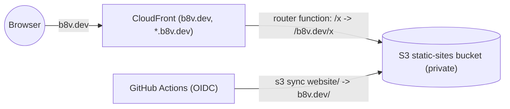

# b8v.dev

Personal site and blog: a business card at `/` and a blog at `/blog.html`. Plain static
files, no build step and no backend.

## How it works

- `website/` is the whole site. `blog.html` loads `posts.json` on page load and renders
  the posts; `status.js` shows the last deploy, the commit and how long the posts took to load.
- On every push to `main` that touches `website/`, `.github/workflows/deploy.yml` writes
  `build.json`, syncs `website/` to the `b8v.dev/` prefix of a shared S3 bucket and
  invalidates CloudFront. Pull requests only validate `posts.json`.
- AWS access goes through GitHub OIDC: no access keys are stored anywhere.

Hosting is defined in Terraform in [bleschunov/infra](https://github.com/bleschunov/infra):
one private bucket for all static sites, a CloudFront distribution per domain with a
CloudFront Function that routes by host name (`b8v.dev`, `cv.b8v.dev`, ...), a wildcard
ACM certificate, and the deploy role for this repo. The workflow needs these repository
variables from `terraform output github_variables` there: `AWS_ROLE_ARN`, `S3_BUCKET`,
`S3_PREFIX`, `CLOUDFRONT_DISTRIBUTION_ID`.



## Adding a post

Add an object to the top of `website/posts.json`:

```json
{
  "post_id": "any-unique-id",
  "title": "Post title",
  "posted_at": "2026-11-19T00:00:00",
  "content": "<p class=\"body\">First paragraph.</p>\n\n<p class=\"body\">Second paragraph.</p>"
}
```

`content` is HTML. The blog shows posts in the order of the file, newest first.

## Running locally

```bash
cd website && python3 -m http.server 8000
# http://localhost:8000/blog.html
```

## History

The site started as my take on the
[Cloud Resume Challenge (AWS)](https://cloudresumechallenge.dev/docs/the-challenge/aws/):
the posts lived in DynamoDB behind API Gateway and three Python Lambdas, all in Terraform
in this repo. That stack is in the git history before the switch to static files; the
four existing posts were exported into `posts.json`.
